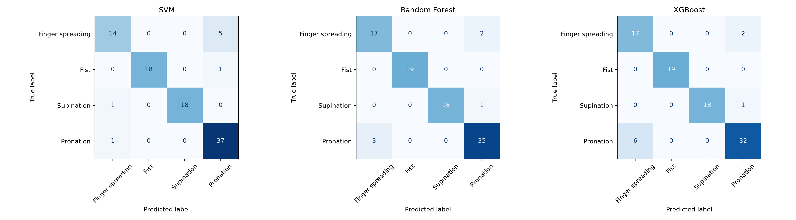

# 6주차: sEMG 모델 재현 및 성능 비교

- 학과: 컴퓨터공학과
- 학번: 23140912
- 이름: 알람

## 1. 코드 설명

### 데이터 및 전처리

Ninapro DB2 피험자 1의 12채널 sEMG 데이터를 사용하였다.
샘플링 주파수는 2,000 Hz이며, 다음 네 동작을 분류하였다.

| 클래스 | 동작          | 원본 동작 ID |
| ------ | ------------- | ------------ |
| 0      | 손가락 벌리기 | 5            |
| 1      | 주먹 쥐기     | 6            |
| 2      | 회외          | 9            |
| 3      | 회내          | 10           |

60 Hz 노치 필터와 20–450 Hz 대역통과 필터를 적용하였다.
각 시행의 연속 동작 구간 가운데 2초를 사용하고,
200 ms 윈도우를 100 ms 간격으로 생성하였다.

채널별 RMS, MAV, WL, ZC, SSC를 계산하여
윈도우마다 60개 특징을 추출하였다.
ZC 임계값은 신호 크기를 고려하여 0으로 설정하였다.

2초보다 짧은 주먹 쥐기 시행 2개를 제외하여 22개 시행을 사용하였다.
원 논문의 8클래스·5채널과 달리, 본 실습은
4클래스·12채널 공개 데이터를 사용한 대체 실험이다.

### 모델 및 학습 방법

- SVM: RBF 커널, C=1.0, gamma='scale'
- Random Forest: 트리 100개, random_state=42
- XGBoost: 트리 400개, max_depth=6, learning_rate=0.05,
  subsample=0.9, colsample_bytree=0.8, random_state=42

윈도우 생성 전에 시행 단위로 학습·테스트 데이터를 분할하였다.
학습 데이터는 17개 시행의 323개 윈도우이고,
테스트 데이터는 5개 시행의 95개 윈도우이다.

세 모델에 동일한 분할을 사용하였다.
StandardScaler는 학습 데이터에만 fit하고 테스트 데이터에는
transform만 적용하였다.

### 실행 방법

필요한 패키지를 설치하고 Jupyter를 실행한다.

```bash
python -m pip install notebook numpy scipy pandas matplotlib scikit-learn xgboost
python -m notebook
```

1. `dataset.npz`와 Week 6 노트북을 같은 폴더에 둔다.
2. Week 6 노트북 첫 셀의 데이터 경로를 다음과 같이 설정한다.

```python
data_path = Path("dataset.npz")
```

3. `week6_semg_assignment_23140912_알람.ipynb`를 열고
   셀을 위에서 아래로 실행한다.

전처리부터 재현하려면 Ninapro DB2의 `S1_E1_A1.mat` 파일을
준비하고 Week 5 노트북의 `data_path`를 실제 파일 위치로 변경한다.
Week 5 노트북을 실행하면 `dataset.npz`를 생성할 수 있다.

데이터 출처: https://ninapro.hevs.ch/instructions/DB2.html

### 파일 설명

| 파일                                        | 역할                                   |
| ------------------------------------------- | -------------------------------------- |
| `week5_semg_assignment_23140912_알람.ipynb` | 전처리, 특징 추출 및 데이터셋 생성     |
| `week6_semg_assignment_23140912_알람.ipynb` | 모델 학습, 평가, 교차검증 및 통계 검정 |
| `dataset.npz`                               | 특징, 라벨, 시행 ID 및 처리 설정       |
| `week6_holdout_results.csv`                 | Hold-out 성능 비교                     |
| `week6_confusion_matrices.png`              | 세 모델의 혼동행렬                     |
| `week6_cv_fold_accuracy.csv`                | 폴드별 정확도                          |
| `week6_cv_summary.csv`                      | 교차검증 평균과 표준편차               |
| `week6_paired_ttests.csv`                   | 대응표본 t-검정 결과                   |
| `week6_computation_cost.csv`                | 학습 및 추론 시간                      |

## 2. 모델 성능 비교

Precision, Recall, F1-score는 macro 평균을 사용하였다.

| Model         | Accuracy | Precision | Recall | F1-score |
| ------------- | -------: | --------: | -----: | -------: |
| SVM           |   91.58% |    93.39% | 90.13% |   91.49% |
| Random Forest |   93.68% |    94.28% | 94.08% |   94.15% |
| XGBoost       |   90.53% |    91.34% | 92.11% |   91.48% |

### 성능 분석

Hold-out 테스트에서는 Random Forest의 정확도와 macro F1이
가장 높았다. 총 95개 윈도우 중 89개를 정확하게 분류했으며,
손가락 벌리기의 오류를 SVM보다 줄이고
회내의 오류를 XGBoost보다 줄였다.

### 교차검증

학습셋에 주먹 쥐기 시행이 3개뿐이므로,
모든 검증 폴드에 네 클래스를 포함하기 위해 3-fold를 사용하였다.
시행 단위로 분할하고 각 학습 폴드에서 표준화를 다시 수행하였다.
Hold-out 테스트셋은 교차검증에 사용하지 않았다.

| Model         | Fold 1 | Fold 2 | Fold 3 | 평균 ± 표준편차 |
| ------------- | -----: | -----: | -----: | --------------: |
| SVM           | 98.25% | 94.74% | 93.68% |  95.56% ± 1.95% |
| Random Forest | 96.49% | 85.09% | 90.53% |  90.70% ± 4.66% |
| XGBoost       | 93.86% | 87.72% | 92.63% |  91.40% ± 2.65% |

교차검증에서는 SVM의 평균 정확도가 가장 높았다.
Hold-out과 순위가 달라 데이터 분할에 따른 영향을 확인하였다.

### 통계 검정

| 비교                     | 대응표본 t-검정 p-value |
| ------------------------ | ----------------------: |
| SVM vs Random Forest     |                  0.1840 |
| SVM vs XGBoost           |                  0.1379 |
| Random Forest vs XGBoost |                  0.7157 |

모든 p-value가 0.05보다 커서 유의한 차이를 검출하지 못하였다.
이는 성능이 같다는 증거가 아니다.
폴드가 3개뿐이고 학습 데이터가 폴드 사이에서 겹치므로
탐색적 결과로 해석하였다. 다중비교 보정은 적용하지 않았다.

## 3. Confusion Matrix 분석

행은 실제 클래스, 열은 예측 클래스이다.
왼쪽부터 SVM, Random Forest, XGBoost 순서이다.



### SVM

- 가장 잘 분류된 클래스: 회내, 재현율 97.37% (37/38)
- 가장 많이 오분류된 클래스: 손가락 벌리기, 5개 오류
- 주요 오분류 유형: 손가락 벌리기 → 회내, 5개
- 원인 분석: 일부 손가락 벌리기 특징이 회내와 비슷했을 가능성이
  있으나, 혼동행렬만으로 원인을 확정할 수 없다.

### Random Forest

- 가장 잘 분류된 클래스: 주먹 쥐기, 재현율 100% (19/19)
- 가장 많이 오분류된 클래스: 회내, 3개 오류
- 주요 오분류 유형: 회내 → 손가락 벌리기, 3개
- 원인 분석: 두 동작의 특징이 일부 겹쳤을 가능성이 있다.
  더 많은 시행을 통해 같은 오류가 반복되는지 확인해야 한다.

### XGBoost

- 가장 잘 분류된 클래스: 주먹 쥐기, 재현율 100% (19/19)
- 가장 많이 오분류된 클래스: 회내, 6개 오류
- 주요 오분류 유형: 회내 → 손가락 벌리기, 6개
- 원인 분석: 현재 학습 데이터와 모델 설정에서는 일부 회내
  윈도우를 손가락 벌리기와 구분하기 어려웠다.
  특징 중첩이나 시행 간 차이가 원인일 수 있지만 추가 확인이 필요하다.

## 4. 최종 결과

- Hold-out에서 가장 좋은 모델: Random Forest
- Hold-out에서 가장 낮은 정확도를 보인 모델: XGBoost
- 교차검증 평균 정확도가 가장 높은 모델: SVM
- 주요 혼동 동작: 손가락 벌리기와 회내

### 계산 비용

| 모델          | 학습 시간 (초) | 평균 추론 시간 (ms/윈도우) |
| ------------- | -------------: | -------------------------: |
| SVM           |         0.0214 |                     0.3142 |
| Random Forest |         0.0857 |                    14.0558 |
| XGBoost       |         0.3769 |                     0.2915 |

측정 환경은 macOS 26.5.1, ARM64, Python 3.12.4,
scikit-learn 1.9.0, XGBoost 3.4.1이다.
학습 시간은 1회 측정값이며, 추론 시간은 준비 실행 후
단일 윈도우 예측을 100회 반복한 평균이다.
표준화는 포함하지만 필터링과 특징 추출 시간은 제외하였다.
실행 환경과 병렬 처리 설정에 따라 측정값은 달라질 수 있다.

### 한계 및 느낀 점

한 피험자의 데이터만 사용했으므로 새로운 사람에 대한 성능을
확인하지 못하였다. 또한 테스트 시행과 교차검증 폴드 수가 적고,
겹치는 윈도우를 독립적인 실험으로 볼 수 없다.
짧은 시행을 제외하여 클래스별 데이터 수에도 차이가 있다.

정확도가 높은 모델이 모든 조건에서 가장 좋은 것은 아니었다.
오류 유형, 분할에 따른 변동, 계산 비용을 함께 비교해야 한다는
것을 배웠다. 이번 결과만으로 특정 모델이 통계적으로 우수하다고
결론 내리기는 어렵다.
